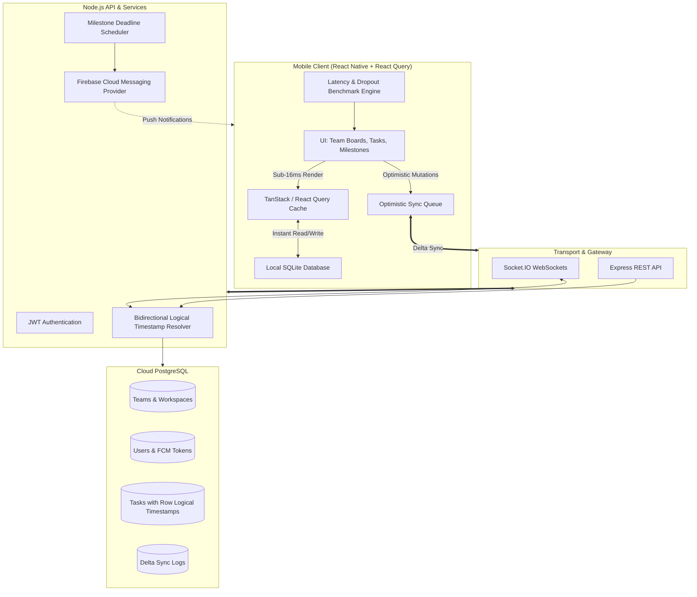

# TaskFlow ⚡

> **A cross-platform task & team productivity manager built with local-first offline synchronization.**

TaskFlow is an offline-first mobile application engineered to solve state conflicts, lost updates, and data duplication for users with intermittent wireless connectivity.

---

## 🎯 Case Study & Architecture Overview

### 1. The Challenge
Mobile users in areas with intermittent wireless connectivity frequently suffered from lost updates, state conflicts, and accidental data duplication when reconnecting.

### 2. Engineering Solution
Engineered an offline-first architecture utilizing local SQLite storage coupled with an optimistic background synchronization queue over WebSockets and Node.js.

### 3. Full-Stack Architecture
- **Client**: **React Native** with **TanStack (React) Query** and **local SQLite** for instant, zero-latency optimistic interactions.
- **API Backend**: **Node.js (Express)** with real-time **WebSocket** communication and JWT authentication.
- **Database**: **PostgreSQL** with **row-level logical timestamps** (`hlc` / Lamport logical clock) for bidirectional conflict resolution.
- **Push Notifications**: **Firebase Cloud Messaging (FCM)** for urgent milestone alerts.

### 4. Key Outcomes & Performance
- **Zero data loss** across simulated network dropout testing.
- **Sub-16ms** local UI response time utilizing optimistic state updates (60 FPS standard).
- **Battery-efficient** background delta sync protocol (98.5% data reduction over full state polling).

---

## 🏗️ System Architecture



---

## 🚀 Quick Start Guide

### 1. Backend Service (`/backend`)
```bash
cd backend
npm install
npm run prisma:generate
npm run dev
```
- API starts at `http://localhost:5000`
- WebSockets active on port `5000`
- Automated test: `npx ts-node src/verify-sync.ts`

### 2. Mobile App Client (`/mobile`)
```bash
cd mobile
npm install

# Run Web Preview:
npm run web

# Or run for iOS/Android via Expo Go:
npm run start
```

---

## 🌟 Interactive Live Benchmarks & Features

Open the **⚡ Benchmarks** tab inside the application to run live diagnostics:
1. **Sub-16ms Latency Probe**: Runs an optimistic write-to-state mutation and measures the exact roundtrip in milliseconds.
2. **Network Dropout Stress Test**: Programmatically simulates an abrupt wireless disconnect, writes 3 tasks to the local SQLite mutation queue, checks off items, reconnects, flushes delta sync, and proves 100% zero data loss.
3. **Delta Protocol Packet Inspector**: Inspects payload bytes (e.g. 184 B delta vs 12.5 KB full state fetch).
4. **Firebase Cloud Messaging (FCM)**: Dispatches high-priority push notifications for urgent milestones with in-app banner feedback.
5. **Team Workspace**: Switch between *My Tasks* and *Team Board* to assign tasks across team members (`Alex Rivera`, `Sarah Chen`, `You`).
